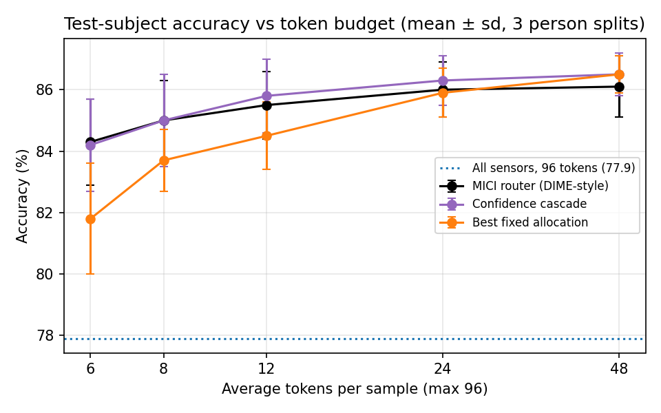
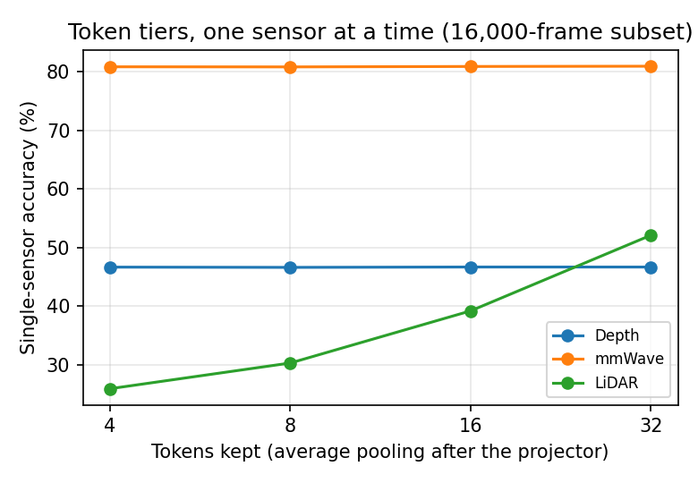

# Per-sample sensor token allocation on a frozen multimodal model (pilot)

A small feasibility study: when a multimodal human-sensing model receives several sensors, can each sample decide **how many tokens each sensor gets**, and spend far fewer tokens without losing accuracy?

Everything runs on the released [X-Fi](https://github.com/xyanchen/X-Fi) checkpoint for MM-Fi action recognition, kept frozen. The only trained component is a small router.



## Setup

- **Model:** X-Fi (Chen & Yang, ICLR 2025), official MM-Fi HAR weights, not fine-tuned.
- **Data:** the MM-Fi validation split (64,152 frames, 40 subjects, 27 actions), which X-Fi was not trained on. Sensors: depth, LiDAR, mmWave (RGB off).
- **Token tiers:** X-Fi maps each sensor to 32 tokens after its projector. Each sensor gets 0, 4, 8, 16 or 32 tokens by average-pooling those 32 tokens (0 = the sensor is not fed at all). That gives 124 non-empty allocations, at most 96 tokens. With every active sensor at 32, the forward pass is exactly X-Fi's own (`src/check_equiv.py`).
- **Offline sweep:** every frame is run under all 124 allocations, storing the logits.
- **MICI label:** the value of upgrading one sensor by one tier, measured as the drop in −ln p(true class).
- **Router:** a 2-layer MLP (about 80k parameters) that sees the current tiers, simple sensor quality cues and X-Fi's current prediction (top-3 probabilities, entropy), and predicts the MICI of each possible one-tier upgrade. At test time it greedily takes the best predicted gain per added token until that falls below a threshold λ. This is the dynamic feature selection recipe of DIME (Gadgil et al., ICLR 2024), applied to token tiers.
- **Evaluation:** router train and test halves are split by person; all numbers are means over 3 person splits.

## Results

Accuracy (%) at a given average number of tokens per sample (mean ± sd over 3 splits):

| Method | 6 | 8 | 12 | 24 | 48 |
|---|---|---|---|---|---|
| MICI router | 84.3 ± 1.4 | **85.0 ± 1.3** | 85.5 ± 1.1 | 86.0 ± 0.9 | 86.1 ± 1.0 |
| Confidence cascade | 84.2 ± 1.5 | **85.0 ± 1.5** | 85.8 ± 1.2 | 86.3 ± 0.8 | 86.5 ± 0.7 |
| Best fixed allocation | 81.8 ± 1.8 | 83.7 ± 1.0 | 84.5 ± 1.1 | 85.9 ± 0.8 | 86.5 ± 0.6 |
| All three sensors at 32 tokens (96) | | | | | 77.9 |

The cascade is charged with fair accounting (each sensor pays for the most tokens it held along the cascade path); see `results/fair_cost/`.

**What the allocation signal is worth (hindsight upper bounds).** Using the same greedy rule but with the true value of each upgrade, at 8 tokens on average:

| Value of an upgrade | Accuracy |
|---|---|
| MICI (drop in −ln p of the true class) | 93.3 |
| Change in correctness (0/1) | 90.2 |
| Change in top-class confidence (label-free) | 71.9 |

These use the labels, so they are ceilings, not methods.

**Token tiers after the mixing projector.** One sensor at a time, depth and mmWave accuracy are flat from 4 to 32 tokens; only LiDAR improves with more tokens.



## Findings, stated plainly

- Per-sample allocation helps a lot over feeding everything: about 8 tokens on average reach 85.0%, against 77.9% with all sensors at 96 tokens, and 1.3 points above the best fixed allocation at that budget.
- **The learned router only ties a simple confidence cascade.** Adding encoder features or a small transformer router with history (`router_v2.py`, `router_v3.py`) did not change this.
- **Intermediate tiers are not shown to be useful.** Because X-Fi's tokens after the projector are highly redundant, the choice on this model is mostly *which sensors to switch on*, not how many tokens each gets.
- MICI is a better allocation signal than correctness or confidence in hindsight, but the router cannot predict it well enough from the information it sees. LiDAR processing in X-Fi is also stochastic (random farthest-point sampling start), which makes MICI labels noisy.
- Scope: one model, one dataset, one classification task.
- My reproduction of X-Fi is 0.9 to 4.6 points below the X-Fi paper, depending on the sensor combination (for example 77.9 vs 80.5 for all three sensors, 81.1 vs 85.7 for mmWave alone).

**Future work (proposed, not built here):** the same allocation question on a multimodal LLM such as HoloLLM, where cost actually scales with token count, plus cleaner MICI labels (fixed or averaged LiDAR sampling).

## Repository layout

```
src/
  token_alloc.py         per-sensor token pooling and the X-Fi fusion pass with variable-length token lists
  eval_combos.py         X-Fi on the 7 sensor combinations (reproduction)
  eval_alloc.py          sweep all 124 allocations, save logits
  check_equiv.py         check the shared-feature fast path matches X-Fi's own forward pass
  extract_feats.py       encoder summaries and the fusion-attention probe for router inputs
  analyze_alloc.py       MICI labels, MICI router, cascade / fixed / even / random / oracle baselines
  router_v2.py           router with encoder features; attention-share allocation baseline
  router_v3.py           small transformer router with upgrade history
  signal_compare.py      hindsight comparison of allocation signals
  fair_cost.py           fair token accounting for the cascade (main table above)
  cum_cost.py            cost counted over every X-Fi pass a method needs
  neighbor_mici.py       neighbour-averaged MICI labels / kNN router
  sensor_cut.py, sensor_cut_analyze.py   tier test with cuts before and after the projector
  headroom.py, plot_zoom.py, make_figures.py   oracle headroom and plotting
  pilot_paths.py         data and results locations (env vars PILOT_RESULTS, MMFI_ROOT)
scripts/                 resumable 8-piece sweep and feature-extraction loops
results/                 summary JSON files and figures from the runs (labels in Chinese)
figures/                 English figures for this README
```

The large per-frame logit and feature arrays (several GB) are not included; `scripts/` regenerates them.

## Reproducing

1. Clone [X-Fi](https://github.com/xyanchen/X-Fi), install its requirements and download its MM-Fi HAR weights as described there.
2. Download the MM-Fi dataset from the [MM-Fi repository](https://github.com/ybhbingo/MMFi_dataset) (only the validation subjects and the depth, LiDAR and mmWave modalities are needed) and set `MMFI_ROOT` to it.
3. Run the sweep from X-Fi's `MMFi_HAR` folder (one GPU, about 8 GB is enough):
   ```bash
   XFI_DIR=/path/to/X-Fi MMFI_ROOT=/path/to/MMFi_Dataset bash scripts/sweep_loop.sh
   XFI_DIR=/path/to/X-Fi MMFI_ROOT=/path/to/MMFi_Dataset bash scripts/feat_loop.sh
   ```
4. Analyses run on CPU from the saved sweep, for example:
   ```bash
   python src/analyze_alloc.py results/alloc_full_p*.npz --out_dir results/alloc_analysis_full
   python src/fair_cost.py
   python src/signal_compare.py
   python src/make_figures.py
   ```

No X-Fi source file is modified or redistributed; `token_alloc.py` re-implements X-Fi's fusion forward pass so it can take a different number of tokens per sensor.

## Acknowledgements and references

- X-Fi: X. Chen and J. Yang. *X-Fi: A Modality-Invariant Foundation Model for Multimodal Human Sensing.* ICLR 2025. Code and weights: https://github.com/xyanchen/X-Fi (Apache-2.0).
- MM-Fi: J. Yang et al. *MM-Fi: Multi-Modal Non-Intrusive 4D Human Dataset for Versatile Wireless Sensing.* NeurIPS 2023 Datasets and Benchmarks.
- DIME: S. Gadgil, I. Covert and S.-I. Lee. *Estimating Conditional Mutual Information for Dynamic Feature Selection.* ICLR 2024.

## License

Apache-2.0, see [LICENSE](LICENSE). The MM-Fi data and X-Fi weights are not part of this repository and keep their own terms.
